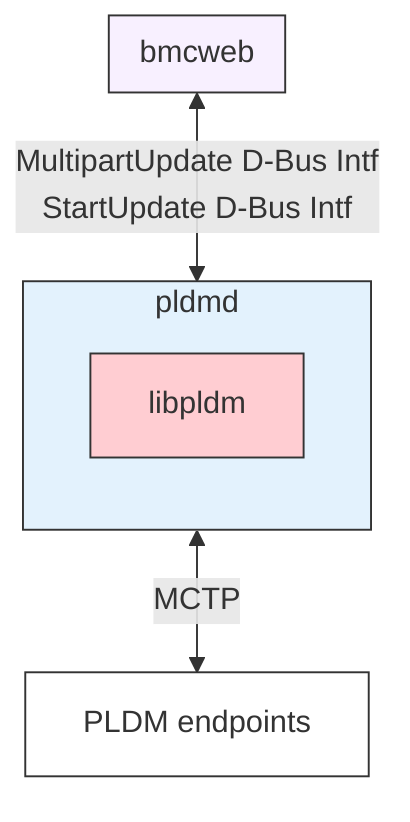

# Code Update Design

Author: Jagpal Singh Gill <paligill@gmail.com>

Other contributors:

- Deepak Kodihalli <deepak.kodihalli.83@gmail.com> @dkodihal
- Tom Joseph <rushtotom@gmail.com> @tomjose

Created: 4th August 2023

Last Updated: Nov 12, 2026

## Problem Description

This section covers the limitations discovered with
[phosphor-bmc-code-mgmt](https://github.com/openbmc/phosphor-bmc-code-mgmt).

1. Current code update flow is complex as it involves 3 different daemons -
   Image Manager, Image Updater and Update Service.
2. Update invocation flow has no explicit interface but rather depends upon the
   discovery of a new file in /tmp/images by Image Manager.
3. Images POSTed via Redfish are downloaded by BMCWeb to /tmp/images which
   requires write access to filesystem. This poses a security risk.
4. Current design doesn't support parallel upgrades for different firmware
   ([Issue](https://github.com/openbmc/bmcweb/issues/257)).

## Background and References

- [phosphor-bmc-code-mgmt](https://github.com/openbmc/phosphor-bmc-code-mgmt)
- [Software DBus Interface](https://github.com/openbmc/phosphor-dbus-interfaces/tree/master/yaml/xyz/openbmc_project/Software)
- [Code Update Design](https://github.com/openbmc/docs/tree/master/architecture/code-update)
- [PLDM for Firmware Update Specification](https://www.dmtf.org/sites/default/files/standards/documents/DSP0267_1.3.0.pdf)
- [Redfish Firmware Update White Paper](https://www.dmtf.org/sites/default/files/standards/documents/DSP2062_1.0.2.pdf)

## Requirements

1. Able to start an update, given a firmware image and update settings.
   - Update settings shall be able to specify when to apply the image, for
     example immediately or on device reset or on-demand.

2. Able to retrieve the update progress and status.
3. Able to produce an interface complaint with
   [Redfish UpdateService](https://redfish.dmtf.org/schemas/v1/UpdateService.v1_11_3.json)
4. Unprivileged daemons with access to DBus should be able to accept and perform
   a firmware update.
5. Update request shall respond back immediately, so client can query the status
   while update is in progress.
6. All errors shall propagate back to the client.
7. Able to support update for different type of hardware components such as
   CPLD, NIC, BIOS, BIC, PCIe switches, etc.
8. Design shall impose no restriction to choose any specific image format.
9. Able to update multiple hardware components of same type running different
   firmware images, for example, two instances of CPLDx residing on the board,
   one performing functionX and other performing functionY and hence running
   different firmware images.
10. Able to update multiple components in parallel.
11. Able to restrict critical system actions, such as reboot for entity under
    update while the code update is in flight.
12. Able to update the components with a multi part image when no Targets are
    specified.
13. Able to order component updates to a device as defined in the multi part
    image format.
14. A firmware component whose name comes from configuration shall keep the same
    firmware inventory object, and hence the same Redfish FirmwareInventory Id,
    across daemon restarts, BMC reboots, device re-discovery and updates.

## Proposed Design

### Proposed End to End Flow

```mermaid
sequenceDiagram;
participant CL as Client
participant BMCW as BMCWeb
participant CU as <deviceX>CodeUpdater<br> ServiceName: xyz.openbmc_project.Software.<deviceX>

% Bootstrap Action for CodeUpdater
note over CU: Get device access info from<br> /xyz/openbmc_project/inventory/system/... path
note over CU: SwId = <ConfiguredName> if the name comes from configuration,<br> else <DeviceX>_<RandomId>
CU ->> CU: Create Interface<br> xyz.openbmc_project.Software.Update<br> at /xyz/openbmc_project/Software/<SwId>
CU ->> CU: Create Interface<br> xyz.openbmc_project.Software.Version<br> at /xyz/openbmc_project/Software/<SwId>
CU ->> CU: Create Interface<br>xyz.openbmc_project.Software.Activation<br> at /xyz/openbmc_project/Software/<SwId> <br> with Status = Active
CU ->> CU: Create functional association <br> from Version to Inventory Item

CL ->> BMCW: HTTP POST: /redfish/v1/UpdateService/update <br> (Image, settings, RedfishTargetURIArray)

loop For every RedfishTargetURI
  note over BMCW: Map RedfishTargetURI /redfish/v1/UpdateService/FirmwareInventory/<SwId> to<br> Object path /xyz/openbmc_project/software/<SwId>
  note over BMCW: Get serviceName corresponding to the object path <br>from mapper.
  BMCW ->> CU: StartUpdate(Image, ApplyTime)

  note over CU: UpdateId = a new Id unique per StartUpdate,<br> for example <DeviceX>_<RandomId>
  note over CU: ObjectPath = /xyz/openbmc_project/software/<UpdateId>
  CU ->> CU: Create Interface<br>xyz.openbmc_project.Software.Activation<br> at ObjectPath with Status = NotReady
  CU -->> BMCW: {ObjectPath, Success}
  CU ->> CU: << Delegate Update for asynchronous processing >>

  par BMCWeb Processing
      BMCW ->> BMCW: Create Matcher<br>(PropertiesChanged,<br> xyz.openbmc_project.Software.Activation,<br> ObjectPath)
      BMCW ->> BMCW: Create Matcher<br>(PropertiesChanged,<br> xyz.openbmc_project.Software.ActivationProgress,<br> ObjectPath)
      BMCW ->> BMCW: Create Task<br> to handle matcher notifications
      BMCW -->> CL: <TaskNum>
      loop
          BMCW --) BMCW: Process notifications<br> and update Task attributes
          CL ->> BMCW: /redfish/v1/TaskMonitor/<TaskNum>
          BMCW -->>CL: TaskStatus
      end
  and << Asynchronous Update in Progress >>
      note over CU: Verify Image
      break Image Verification FAILED
        CU ->> CU: Activation.Status = Invalid
        CU --) BMCW: Notify Activation.Status change
      end
      CU ->> CU: Activation.Status = Ready
      CU --) BMCW: Notify Activation.Status change

      opt SwId is not a configured name
          CU ->> CU: Create Interface<br> xyz.openbmc_project.Software.Version<br> at ObjectPath
      end
      CU ->> CU: Create Interface<br>xyz.openbmc_project.Software.ActivationProgress<br> at ObjectPath
      CU ->> CU: Create Interface<br> xyz.openbmc_project.Software.ActivationBlocksTransition<br> at ObjectPath
      CU ->> CU: Activation.Status = Activating
      CU --) BMCW: Notify Activation.Status change
      note over CU: Start Update
      loop
          CU --) BMCW: Notify ActivationProgress.Progress change
      end
      note over CU: Finish Update
      alt ApplyTime != Immediate and SwId is a configured name
          CU ->> CU: Activation.Status = Staged at ObjectPath
          CU --) BMCW: Notify Activation.Status change
          note over CU: When the reset runs the image, update<br> Software.Version properties at<br> /xyz/openbmc_project/software/<SwId>, then<br> Activation.Status = Active at ObjectPath
      else
          CU ->> CU: Activation.Status = Active
          CU --) BMCW: Notify Activation.Status change
          CU ->> CU: Delete Interface<br> xyz.openbmc_project.Software.ActivationBlocksTransition
          CU ->> CU: Delete Interface<br> xyz.openbmc_project.Software.ActivationProgress
          alt ApplyTime == Immediate
              note over CU: Reset Device
              alt SwId is a configured name
                  CU ->> CU: Update Software.Version properties<br> at /xyz/openbmc_project/software/<SwId>
                  note over CU: Remove ObjectPath once its final<br> Activation.Status has been emitted
              else
                  CU ->> CU: Update functional association to System Inventory Item
                  CU ->> CU: Create Interface<br> xyz.openbmc_project.Software.Update<br> at ObjectPath
                  note over CU: Delete all interfaces on previous ObjectPath
              end
          else
              note over CU: Create active association to System Inventory Item
          end
      end
  end
end
```



- Each upgradable hardware type may have a separate daemon (\<deviceX\> as per
  above flow) handling its update process and would need to implement the
  proposed interfaces in next section. This satisfies the
  [Requirement# 6](#requirements).
- Since, there would be single daemon handling the update (as compared to
  three), less hand shaking would be involved and hence addresses the
  [Issue# 1](#problem-description) and [Requirement# 4](#requirements).

### Proposed D-Bus Interface

The DBus Interface for code update will consist of following -

| Interface Name                                                                                                                                                                                         | Existing/New |                                                   Purpose                                                   |
| :----------------------------------------------------------------------------------------------------------------------------------------------------------------------------------------------------- | :----------: | :---------------------------------------------------------------------------------------------------------: |
| [xyz.openbmc_project.Software.Update](https://gerrit.openbmc.org/c/openbmc/phosphor-dbus-interfaces/+/65738)                                                                                           |     New      |                                           Provides update method                                            |
| [xyz.openbmc_project.Software.MultipartUpdate](https://gerrit.openbmc.org/c/openbmc/phosphor-dbus-interfaces/+/78905)                                                                                  |     New      | Interface to identify the multi part updater which can do code update based on the multi-part image format. |
| [xyz.openbmc_project.Software.Version](https://github.com/openbmc/phosphor-dbus-interfaces/blob/master/yaml/xyz/openbmc_project/Software/Version.interface.yaml)                                       |   Existing   |                                            Provides version info                                            |
| [xyz.openbmc_project.Software.Activation](https://github.com/openbmc/phosphor-dbus-interfaces/blob/master/yaml/xyz/openbmc_project/Software/Activation.interface.yaml)                                 |   Existing   |                                         Provides activation status                                          |
| [xyz.openbmc_project.Software.ActivationProgress](https://github.com/openbmc/phosphor-dbus-interfaces/blob/master/yaml/xyz/openbmc_project/Software/ActivationProgress.interface.yaml)                 |   Existing   |                                   Provides activation progress percentage                                   |
| [xyz.openbmc_project.Software.ActivationBlocksTransition](https://github.com/openbmc/phosphor-dbus-interfaces/blob/master/yaml/xyz/openbmc_project/Software/ActivationBlocksTransition.interface.yaml) |   Existing   |                     Signifies barrier for state transitions while update is in progress                     |
| [xyz.openbmc_project.Software.RedundancyPriority](https://github.com/openbmc/phosphor-dbus-interfaces/blob/master/yaml/xyz/openbmc_project/Software/RedundancyPriority.interface.yaml)                 |   Existing   |                         Provides the redundancy priority for the version interface                          |
| [xyz.openbmc_project.Software.Asset](https://github.com/openbmc/phosphor-dbus-interfaces/tree/master/yaml/xyz/openbmc_project/Software/Asset.interface.yaml)                                           |     New      |                             Provides Manufacturer and Release Date information                              |

Introduction of xyz.openbmc_project.Software.Update interface streamlines the
update invocation flow and hence addresses the [Issue# 2](#problem-description)
and [Requirement# 1 & 2](#requirements).

#### Association

`running` : A `running` association from xyz.openbmc_project.Inventory.Item to
xyz.openbmc_project.Software.Version represents the current functional or
running software version for the associated inventory item. The `ran_on` would
be the corresponding reverse association.

`activating` : An `activating` association from
xyz.openbmc_project.Inventory.Item to xyz.openbmc_project.Software.Version
represents the activated (but not yet run) software version for the associated
inventory item. There could be more than one active versions for an inventory
item, for example, in case of A/B redundancy models there are 2 associated
flash-banks and xyz.openbmc_project.Software.RedundancyPriority interface
defines the priority for each one.

For A/B redundancy model with staging support, the
xyz.openbmc_project.Software.Activation.Activations.Staged will help to define
which software version is currently staged.

The `activated_on` would be the corresponding reverse association.

### Keep images in memory

Images will be kept in memory and passed to \<deviceX>CodeUpdater using a file
descriptor rather than file path. Implementation needs to monitor appropriate
memory limits to prevent parallel updates from running BMC out of memory.

### Propagate errors to client

xyz.openbmc_project.Software.Update.StartUpdate return value will propagate any
errors related to initial setup and image metadata/header parsing back to user.
Any asynchronous errors which happen during the update process will be notified
via failed activation status which maps to failed task associated with the
update. Also, a phosphor-logging event will be created and sent back to client
via
[Redfish Log Service](https://redfish.dmtf.org/schemas/v1/LogService.v1_4_0.json).

[Redfish events](https://gerrit.openbmc.org/q/topic:%22fw-update-events%22) are
proposed to be used for different update stages which will be reported via
[Redfish Event Services](https://redfish.dmtf.org/schemas/v1/EventService.v1_10_0.json).

### Firmware Image Format

Image parsing will be performed in \<deviceX>CodeUpdater and since
\<deviceX>CodeUpdater may be a device specific daemon, vendor may choose any
image format for the firmware image. This fulfills the
[Requirement# 7](#requirements).

#### PLDM Image Packaging

The PLDM for
[Firmware Update Specification](https://www.dmtf.org/sites/default/files/standards/documents/DSP0267_1.3.0.pdf)
provides a standardized packaging format for images, incorporating both standard
and user-defined descriptors. This format can be utilized to package firmware
update images for non-PLDM devices as well. For such devices, the CodeUpdater
will parse the entity manager configuration to identify applicable PLDM
descriptors, which can include but are not limited to the following -

| PLDM Package Descriptor | Descriptor Type |                                                                                           Description                                                                                            |
| :---------------------: | :-------------: | :----------------------------------------------------------------------------------------------------------------------------------------------------------------------------------------------: |
|   IANA Enterprise ID    |    Standard     |                                       [IANA Enterprise Id](https://www.iana.org/assignments/enterprise-numbers/enterprise-numbers) of the hardware vendor                                        |
|       ASCII Model       |    Standard     | Compatible hardware name (com.\<vendor\>.Hardware.\<XXX\>) specified by hardware vendor in [phosphor-dbus-interfaces](https://github.com/openbmc/phosphor-dbus-interfaces/tree/master/yaml/com). |

#### Entity Manager Configuration

The entity manager configuration can provide firmware-related information as
part of board configurations, which can be utilized for firmware validation and
modeling device access details. These D-Bus objects can then be consumed by the
CodeUpdater service to manage updates for the relevant firmware entities.

For common firmware info definition
[refer](https://gerrit.openbmc.org/c/openbmc/entity-manager/+/75947)

The following example is one such instance of this definition for an i2c CPLD
device firmware.

```json
"Exposes": [
  ...
  {
    "Name": "MB_LCMX02_2000HC",
    "Type": "CPLDFirmware",
    ...
    "FirmwareInfo" :
    {
      "VendorIANA": 0000A015,
      "CompatibleHardware": "com.meta.Hardware.Yosemite4.MedusaBoard.CPLD.LCMX02_2000HC"
    }
    ...
  },
  ...
]
```

- `Name`: The name of the firmware entity instance.
- `Type`: This field is used by the CodeUpdater service to determine which
  firmware EM configurations it should process.
- `VendorIANA`: This field maps to the `IANA Enterprise ID` descriptor in PLDM
  package header.
- `CompatibleHardware`: This field maps to the `ASCII Model` descriptor in PLDM
  package header.

### Pre and Post Update Conditions

Certain device updates may necessitate specific configurations or actions to be
executed before or after the update process. One such example of a post update
action is the device reset. While these actions can be integrated into the
update process for some updaters, it is often ideal to define them as structured
hooks within the firmware update process. This section aims to establish such
hooks for applicable updaters.

#### JSON schema for Configuration

The Code Updater daemon can be configured to execute platform-specific pre and
post update systemd targets, as defined by the JSON schema definition below:

```json
{
  "$schema": "http://json-schema.org/draft-04/schema#",
  "type": "array",
  "items": [
    {
      "description": "The definition for the pre and post update targets",
      "type": "object",
      "properties": {
        "Identifier": {
          "type": "string",
          "description": "The unique identifier for a device or a component."
        },
        "PreUpdateTarget": {
          "type": "string",
          "description": "The systemd target service that should be run before starting an update."
        },
        "PostUpdateTarget": {
          "type": "string",
          "description": "The systemd target service that should be run after an update has finished successfully."
        }
      },
      "additionalProperties": false
    }
  ]
}
```

- `Identifier` maps to `DeviceX` defined in the preceding sections.

#### Example Configuration

```json
[
  {
    "Identifier": "Device1",
    "PostUpdateTarget": "ABC_PostUpdate.service"
  },
  {
    "Identifier": "Device2_ComponentX",
    "PreUpdateTarget": "XYZ_PreUpdate.service",
    "PostUpdateTarget": "XYZ_PostUpdate.service"
  },
  {
    "Identifier": "Device3_ComponentY",
    "PreUpdateTarget": "JKL_PreUpdate.service",
    "PostUpdateTarget": "JKL_PostUpdate.service"
  }
]
```

#### Executing Pre/Post Update Services

If no pre or post service is specified for an `Identifier`, it will be skipped.
However, if a service is specified, it will be triggered and if the start fails,
error handling procedures shall be executed accordingly.

To start these services, the CodeUpdater uses the
[StartUnit](https://www.freedesktop.org/software/systemd/man/latest/org.freedesktop.systemd1.html)
method from org.freedesktop.systemd1.Manager interface exposed by systemd
service.

#### Handling Pre/Post Update Service Completion

For a triggered pre/post update service, the CodeUpdater waits for completion by
registering for the
[JobRemoved](https://www.freedesktop.org/software/systemd/man/latest/org.freedesktop.systemd1.html)
signal for org.freedesktop.systemd1.Manager interface. Depending on the returned
status, the CodeUpdater decides to fail or proceed further and updates the
activation status accordingly.

systemd emits `JobRemoved` exactly once for every job it dequeues, whether that
job ran to completion, failed to start, was cancelled or superseded by another
job, or was terminated on a timeout. A job returned by `StartUnit` therefore
always ends with one such signal, so the CodeUpdater needs no timeout of its own
to observe completion. Only the job result `done` is treated as success; any
other result, such as `failed`, `timeout` or `canceled`, fails the condition.

#### Handling Hanging Tasks

To handle ever-hanging tasks, pre and post update services can bound their own
execution time, which helps terminate the hanging service and deliver the
designated state via the JobRemoved signal. The directive to use depends on the
service type: `TimeoutStartSec` bounds a `Type=oneshot` service, for which
`RuntimeMaxSec` is ignored, while `RuntimeMaxSec` caps the runtime of a service
that reaches the active state.

Bounding the execution time is the responsibility of the service, as the
CodeUpdater applies no timeout of its own. A service that can hang without such
a bound leaves the update waiting indefinitely.

### Multi part Images

A multi part image has multiple component images as part of one image package.
PLDM image is one such example of multi part image format. Sometimes, for multi
part devices there is no concrete physical firmware device but firmware device
itself consists of multiple physical components, each of which may have its own
component image. In such a scenario, \<deviceX>CodeUpdater can create a logical
inventory item for the firmware device. While performing the firmware device
update, the client may target the logical firmware device which further knows
how to update the corresponding child components for supplied component images.
The user can also update the specific component by providing the image package
with component as head node. The \<deviceX>CodeUpdater can implement the
required logic to verify if the supplied image is targeted for itself (and child
components) or not.

### Multi part image handling w/o Targets

A service intended to process firmware updates via a multi-part image, without
explicit update targets, is required to implement the
xyz.openbmc_project.Software.MultipartUpdate interface. The system permits only
a single instance of this interface. If no targets are provided, bmcweb searches
for the service exposing this interface and invokes the StartUpdate method at
the associated object path.

The PLDM package is an example of multi-part image format. At the application
layer, the pldmd daemon implements both
xyz.openbmc_project.Software.MultipartUpdate and
xyz.openbmc_project.Software.Update D-Bus interfaces. Upon receiving a PLDM
package, pldmd parses the content, applies the component-matching algorithm as
defined by the PLDM Type 5 specification, and initiates firmware updates for
relevant PLDM devices, also ensuring component updates are ordered per firmware
device. This implementation does not cover scenario where PLDM package can be
used to update PLDM and Non-PLDM devices.

pldmd implements standard interfaces:

- `xyz.openbmc_project.Software.MultipartUpdate`
- `xyz.openbmc_project.Software.Update`
- `xyz.openbmc_project.Software.Activation`
- `xyz.openbmc_project.Software.ActivationProgress`



### Update multiple devices of same type

- For same type devices, each device instance needs its own D-Bus path. When the
  name of a component comes from configuration, that name identifies the
  instance and is the whole path name, see
  [Firmware Inventory Object Identity](#firmware-inventory-object-identity).
  Otherwise, extend the Dbus path to specify device instance, for example,
  /xyz/openbmc_project/Software/\<deviceX>\_\<InstanceNum>\_\<SwId>.
  xyz.openbmc_project.Software.Update.StartUpdate on this path returns a
  separate path for each update, as in the
  [Proposed End to End Flow](#proposed-end-to-end-flow).

This fulfills the [Requirement# 9](#requirements).

### Firmware Inventory Object Identity

BMCWeb uses the last element of a firmware inventory object path as the Redfish
FirmwareInventory Id. A random part in that element changes the Id on every
daemon restart, BMC reboot and update, so a client cannot store an Id, reuse a
`Targets` URI after an update, or follow an event to the object it names.

A firmware component has a configured name when its own configuration names it,
for example an entity-manager record that lists the component. A name that an
updater builds from a device name, a bus or transport address, discovery order
or data the device reports is not a configured name. A component with a
configured name keeps one firmware inventory object for its whole lifetime:

- The object path is `/xyz/openbmc_project/software/<ConfiguredName>`, a direct
  child of `/xyz/openbmc_project/software` with no random part. The Redfish
  FirmwareInventory Id is the configured name.
- The configured name starts with a letter and contains only letters, digits and
  `_`, so it is a D-Bus path element that needs no escaping. An updater that
  cannot use a configured name this way logs an error and treats the component
  as having no configured name.
- The object hosts xyz.openbmc_project.Software.Version,
  xyz.openbmc_project.Software.Update and
  xyz.openbmc_project.Software.Activation with Status = Active, and the
  `running` association to its inventory item.
- The object keeps its path across daemon restarts, BMC reboots, re-discovery of
  the device, including discovery at a new bus or transport address, and
  updates.
- After an update, whether it succeeds or fails, and after re-discovery, the
  object is refreshed in place: changed properties are updated and signaled with
  PropertiesChanged. The object is not removed and published again.

xyz.openbmc_project.Software.Update.StartUpdate on the object returns a separate
per-update path, for example `<ConfiguredName>_<RandomId>`:

- The per-update path is unique to the call and never equal to a configured name
  in use. StartUpdate never returns the firmware inventory object path.
- The per-update object hosts xyz.openbmc_project.Software.Activation,
  xyz.openbmc_project.Software.ActivationProgress and
  xyz.openbmc_project.Software.ActivationBlocksTransition as in the
  [Proposed End to End Flow](#proposed-end-to-end-flow). It does not host
  xyz.openbmc_project.Software.Version, so it never appears as a separate
  FirmwareInventory member.
- The per-update object stays published at least until its final
  Activation.Status has been emitted, and may be removed afterwards.
- When the image is applied at a later reset, the per-update object reports
  Activation.Status = Staged, and Active once the reset runs the new image. The
  firmware inventory object is refreshed at that point. An updater that applies
  images immediately never reports Staged.
- Update events that refer to the component, for example through their
  `TARGET_NAME`, name the firmware inventory object path, not the per-update
  path.

When the device of a configured component is removed but its configuration
remains, its firmware inventory object stays published with the last known
version, so the Redfish FirmwareInventory member and its Id remain available.
While the device is absent the updater removes
xyz.openbmc_project.Software.Update from the object, which BMCWeb reports as
`Updateable` false. When the device returns, the updater adds the interface back
and refreshes the object at the same path. The object is not kept across a
daemon restart or BMC reboot; it is published again when the device is
discovered. When the configuration that names the component is removed, the
object is removed and its name can be used again.

Configured names must be unique across the system and must not use a path
element that another service already publishes under
`/xyz/openbmc_project/software`, such as `bmc`, `functional`, `updateable`,
`active`, `apply_time` or `pldm`. A configuration that applies to more than one
instance, for example one per slot, makes the name unique for each instance, for
example by including the instance in the name.

A duplicate configured name is a configuration error: the updater keeps the
object it published first, does not publish the second one, and logs an error
naming both configuration records. A configuration record is identified by its
configuration object, for example its entity-manager object path, and the
component it names. A record that is discovered again, for example at a new
transport address, takes its own name over and is not a duplicate. An updater
can only check the names it publishes itself; uniqueness across services is the
responsibility of the configuration.

Components whose name does not come from configuration keep the
`<DeviceX>_<RandomId>` form, and their objects behave as before.

All software objects are direct children of `/xyz/openbmc_project/software`.
Relationships between them, for example between a device-level object and the
components of that device, are expressed with associations rather than nested
paths.

This fulfills the [Requirement# 14](#requirements).

### Parallel Upgrade

- Different type hardware components:

  Upgrade for different type hardware components can be handled either by
  different `<deviceX>CodeUpdater` daemons or by a single daemon for hardware
  components with common features, for example, PLDMd may handle update for
  devices using PLDM specification. Such updates can be invoked in parallel from
  BMCWeb and tracked via different tasks.

- Similar type hardware component:

  BMCWeb will trigger xyz.openbmc_project.Software.Update.StartUpdate on
  different D-Bus paths pertaining to each hardware instance. For more details
  on D-Bus paths refer to
  [Update multiple devices of same type](#update-multiple-devices-of-same-type).

This fulfills the [Requirement# 9](#requirements).

### Uninterrupted Updates

`ActivationBlocksTransitions` interface will be created on the specific D-Bus
path for a version update which will help to block any interruptions from
critical system actions such as reboots. This interface can in turn start and
stop services such as Boot Guard Service to prevent such interruptions.

Moreover, when a device is being upgraded the sensor scanning for that device
might need to be disabled. To achieve this, the sensor scanning flow can check
for existence of `ActivationBlocksTransitions` interface on associated `Version`
DBus path for the inventory item. If such interface exists, the sensor scanning
for that device can be skipped by returning back relevant error (such as
`EBUSY`) to the client. Another alternative is to check for existence of
`ActivationBlocksTransitions` interface only if sensor scanning times out. This
won't impact average case performance for sensor scanning but only the worst
case scenario when device is busy, for example, due to update in progress.

## Alternatives Considered

### Centralized Design with Global Software Manager

Single SoftwareManager which communicates with the BCMWeb, hosts all the
interfaces such as Version, Activation, Progress for all hardware components
within the system on different DBus paths. Software Manager keeps list of
various hardware update services within the system and start them based on
update request. These on-demand services update the hardware and interfaces
hosted by Software Manager and exits.

#### Pros

- Most of the DBus interfaces gets implemented by Software Manager and vendors
  would need to write minimal code to change properties for these interfaces
  based on status and progress.
- Under normal operating conditions (no update in flight), only Software Manager
  will be running.

#### Cons

- Imposes the need of a common image format as Software Manager needs to parse
  and verify the image for creating interfaces.
- Limitation in the design, as there is a need to get the current running
  version from the hardware at system bring up. So, Software Manager would need
  to start each update daemon at system startup to get the running version.

### Pull model for Status and Progress

The proposed solution uses a push model where status and progress updates are
asynchronously pushed to BMCWeb. Another alternative would be to use a pull
model where Update interface can have get methods for status and progress (for
example, getActivationStatus and getActivationProgress).

#### Pros

- Server doesn't have to maintain a Dbus matcher
  ([Issue](https://github.com/openbmc/bmcweb/issues/202)).
- Easier implementation in Server as no asynchronous handlers would be required.

#### Cons

- Server would still need maintain some info so it can map client's task status
  request to Dbus path for `/xyz/openbmc_project/Software/<deviceX>` for calling
  getActivationStatus and getActivationProgress.
- Aforementioned [issue](https://github.com/openbmc/bmcweb/issues/202) is more
  of an implementation problem which can be resolved through implementation
  changes.
- Currently, activation and progress interfaces are being used in
  [lot of Servers](#organizational). In future, harmonizing the flow to single
  one will involve changing the push to pull model in all those places. With the
  current proposal, the only change will be in update invocation flow.

### Random Ids for all firmware inventory objects

Every firmware inventory object keeps a `<DeviceX>_<RandomId>` path, as before.

#### Pros

- No naming rules or uniqueness checks for configuration authors.

#### Cons

- The Redfish FirmwareInventory Id changes on every daemon restart, BMC reboot
  and update, so clients cannot store Ids or reuse `Targets` URIs.
- Events and tasks name objects that no longer exist after the update.

### Make the per-update object the firmware inventory object

After an update, the object returned by StartUpdate replaces the previous
firmware inventory object.

#### Pros

- The firmware inventory object always describes the last image written.

#### Cons

- The path, and hence the Redfish Id, still changes on every update.
- Clients watching the previous object lose it.

### Return the firmware inventory object path from StartUpdate

StartUpdate hosts Activation and ActivationProgress on the firmware inventory
object itself.

#### Pros

- No extra object per update.

#### Cons

- A task cannot tell an update's own status changes from those of the steady
  state, so it can complete or fail on the wrong signal.
- Concurrent updates of one component would share one object.

### Remove the firmware inventory object when its device is removed

The firmware inventory object of a configured component is removed with its
device and published again at the same path when the device returns.

#### Pros

- No stale version is ever reported.
- An absent device is visible as a missing FirmwareInventory member.

#### Cons

- The Id returns a 404 while the device is absent, for example during a device
  reset or a recovery, which breaks stored Ids and `Targets` URIs for that time.
- The last known version of the device is lost while it is absent.

The proposed design keeps the member with its last known version and reports the
absence through `Updateable` instead.

## Impacts

The introduction of new DBus API will temporarily create two invocation flows
from Server. Servers (BMCWeb, IPMI, etc) can initially support both the code
stacks. As all the code update daemons gets moved to the new flow, Servers would
be changed to only support new API stack. No user-api impact as design adheres
to Redfish UpdateService.

The Redfish FirmwareInventory Id of a component whose name comes from
configuration changes once, to the configured name, and then stays the same. Ids
of other components are unchanged.

## Organizational

### Does this design require a new repository?

Yes. There will be a device transport level repositories and multiple
\<deviceX>CodeUpdater using similar transport layer can reside in same
repository. For example, all devices using PMBus could have a common repository.

### Who will be the initial maintainer(s) of this repository?

Meta will propose repositories for following devices and `Jagpal Singh Gill` &
`Patrick Williams` will be the maintainer for them.

- VR Update
- CPLD Update

### Which repositories are expected to be modified to execute this design?

Requires changes in following repositories to incorporate the new interface for
update invocation -

| Repository                                                                      | Modification Owner |
| :------------------------------------------------------------------------------ | :----------------- |
| [phosphor-bmc-code-mgmt](https://github.com/openbmc/phosphor-bmc-code-mgmt)     | Jagpal Singh Gill  |
| [BMCWeb](https://github.com/openbmc/bmcweb)                                     | Jagpal Singh Gill  |
| [phosphor-host-ipmid](https://github.com/openbmc/phosphor-host-ipmid)           | Jagpal Singh Gill  |
| [pldm](https://github.com/openbmc/pldm/tree/master/fw-update)                   | Jagpal Singh Gill  |
| [openpower-pnor-code-mgmt](https://github.com/openbmc/openpower-pnor-code-mgmt) | Adriana Kobylak    |
| [openbmc-test-automation](https://github.com/openbmc/openbmc-test-automation)   | Adriana Kobylak    |

NOTE: For
[phosphor-psu-code-mgmt](https://github.com/openbmc/phosphor-psu-code-mgmt) code
seems unused, so not tracking for change.

## Testing

### Unit Testing

All the functional testing of the reference implementation will be performed
using GTest.

### Integration Testing

The end to end integration testing involving Servers (for example BMCWeb) will
be covered using openbmc-test-automation.
