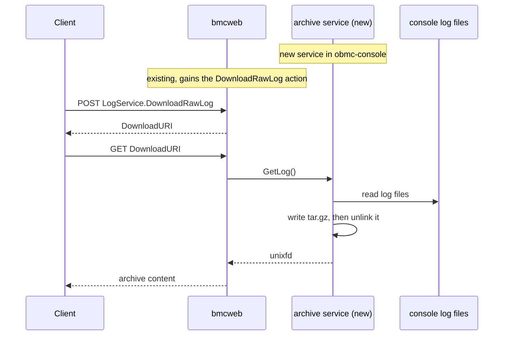

# Host Console Log Download

Author: Prithvi Pai

Created: October 2, 2026

## Problem Description

Host console output is the record of what host firmware and the operating system
printed, and it is what gets examined when a host fails to boot, hangs or
panics. The BMC retains that output across the failure, so it can be read from
the BMC when the host itself cannot be reached.

bmcweb exposes that output through the Redfish `HostLogger` log service as a
collection of entries, one per line of console text. Retrieving a complete
history that way is one resource per line: it costs many requests, returns
several times the underlying bytes once each line is wrapped in a Redfish
envelope, and leaves the client to reassemble the lines before the result can be
read with the tools normally used on a console log.

There is no way to download the console log files themselves. This design adds
one.

## Background and References

[obmc-console](https://github.com/openbmc/obmc-console) writes each console's
output to the file named by that console's `logfile` configuration key, and
optionally a timestamped copy named by `logfile-timestamped`, keeping one
rotated copy of each. Machines place these in different locations:
`/var/log/obmc-console-<id>.log`, `/run/log/obmc-console-<id>.log` and
`/var/log/console_cpu<n>/<subsystem>.log` are all in use today.

The
[LogService v1.9.0 schema](https://redfish.dmtf.org/schemas/v1/LogService.v1_9_0.json)
exposes a `DownloadRawLog` action whose response, `DownloadRawLogResponse`,
carries a required `DownloadURI` property naming the location to download the
raw log from. The log is not returned in the action response itself.

## Requirements

- The BMC must serve the retained console logs in a single request, as the files
  it holds rather than as a line-per-entry collection.
- The files must be served as written, without reformatting or filtering, so
  that what the client receives can be compared against what is on the BMC and
  read with ordinary tools.
- The feature must not grow persistent storage on the BMC. BMC filesystems are
  small and shared with dumps and firmware images, and an archive duplicates
  data the BMC already holds.

## Proposed Design

[obmc-console](https://github.com/openbmc/obmc-console) gains a service that
collects the console log files into a compressed archive and returns it over
D-Bus. bmcweb advertises this as the Redfish `DownloadRawLog` action and serves
the content.

### D-Bus interface

`xyz.openbmc_project.Console.Archive` is served on
`/xyz/openbmc_project/console` and provides one method, `GetLog`, which takes no
arguments and returns a `unixfd` for a `tar.gz` of the console log files. It
defines these errors:

- `xyz.openbmc_project.Console.Archive.Error.NoLogFilesFound` — the console
  configuration names no log file, or none of the files it names is present.
  This is the expected result on a system whose consoles are configured without
  logging.
- `xyz.openbmc_project.Common.File.Error.Open` — a configured log file cannot be
  opened, or the archive file cannot be created. A file rotated away between
  enumeration and open falls here, as does one whose permissions exclude the
  service.
- `xyz.openbmc_project.Common.File.Error.Read` — a log file was opened but
  cannot be read.
- `xyz.openbmc_project.Common.File.Error.Write` — the archive cannot be written,
  the expected cause being no space on the filesystem holding it.

The file set is derived from the console configuration rather than from a fixed
path. It is every console's `logfile` and `logfile-timestamped`, together with
the rotated copy kept alongside each. A console that names no log file
contributes obmc-console's default.

obmc-console is deployed today either as one server process holding a section
per console, or as one server process per console. The archive covers every
console in both cases.

The archive is unlinked before the method returns, so the descriptor sent to the
caller keeps it alive and the content is released when the caller closes it.

`GetLog` is called when the client fetches the download URI, not when the action
is invoked. Nothing is therefore held between the two requests, an archive that
is never downloaded is never built, and the BMC keeps no archive state. The
archive reflects the logs at the time of download rather than at the time the
action was invoked, which is sufficient here because the console log files are
append only.

`GetLog` is served by its own process rather than added as a method to a console
server. In the one-server-per-console deployment each server is configured with
only its own console's log file, so a server answering `GetLog` would return an
archive covering that console alone, and which console you got would depend on
which server happened to own the D-Bus name. A separate process reads the whole
configuration and returns every console's logs in either deployment.

### Redfish

bmcweb advertises `#LogService.DownloadRawLog` on the `HostLogger` log service
only when the `xyz.openbmc_project.Console.Archive` interface is present. The
action returns a `DownloadURI`, as the schema requires, and bmcweb serves the
archive at that location from the descriptor returned by `GetLog`.

## Alternatives Considered

- Archiving a fixed directory. Simpler, but no single location is correct:
  machines place console logs under `/var/log`, under `/run/log` and in
  per-socket subdirectories, so a fixed path would miss logs on some platforms
  and collect unrelated files on others.
- Having bmcweb build the archive itself, so that no new D-Bus interface would
  be needed. Not chosen because it puts collection and compression of an
  unbounded amount of data in the web server, and because bmcweb would have to
  learn the console configuration that obmc-console already parses.
- Following the dump pattern, where `xyz.openbmc_project.Dump.Entry` provides
  `GetFileHandle` and bmcweb serves the content from an attachment URI on a
  persistent entry resource. This would work — the entry can be created on
  demand. It is not chosen because a dump entry is meant to persist: a dump is
  created once, then listed, downloaded again and deleted later. A console log
  archive is built for one download and discarded, so an entry would be created
  and deleted within that download, every time, for no benefit.

## Impacts

- The BMC collects and compresses the console logs when an archive is requested.
  The cost is proportional to the retained log volume and is incurred only on
  request.
- The archive service only reads the log files. It does not write to them, hold
  them open beyond the read, or coordinate with the console servers, so consoles
  stay usable while an archive is built and obmc-console's own logging and
  rotation are unaffected. A rotation during the read can drop a rotated copy
  from the archive; the live file is still collected.
- Nothing other than bmcweb consumes `xyz.openbmc_project.Console.Archive`, so
  the service failing, stopping or restarting is contained to this action.
  bmcweb then stops advertising `DownloadRawLog`, and the rest of the
  `HostLogger` log service is unaffected because the entry collection is read
  from the same files without going through this service. A restart during a
  download fails that transfer and the client retries; nothing accumulates,
  because the archive is unlinked before the descriptor is returned.

### Organizational

The following repositories are involved in this feature:

- [obmc-console](https://github.com/openbmc/obmc-console) gains the archive
  service.
- [phosphor-dbus-interfaces](https://github.com/openbmc/phosphor-dbus-interfaces)
  gains the `xyz.openbmc_project.Console.Archive` interface.
- [bmcweb](https://github.com/openbmc/bmcweb) gains the `DownloadRawLog` action
  on the `HostLogger` log service.

## Testing

### Unit Test

- Path derivation from one configuration with a section per console, and from
  several single-console configurations.
- Archive generation with no log files, with one, and with several.
- Non-regular files and symbolic links are excluded.

### Integration Test

- `GET` the `HostLogger` log service and confirm the action is advertised only
  when the archive service is running.
- `POST` the action, follow the `DownloadURI`, and confirm the archive expands
  to the console log files on the system.
