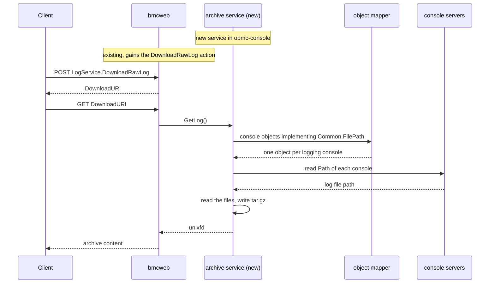

# Host Console Log Download

Author: Prithvi Pai

Created: October 2, 2026

## Problem Description

Host console output is the record of what host firmware and the operating system
printed, and it is what gets examined when a host fails to boot, hangs or
panics. The BMC retains that output across the failure, so it can be read from
the BMC when the host itself cannot be reached.

bmcweb exposes that output through the Redfish `HostLogger` log service as a
collection of entries, one per line of console text. Retrieving a complete
history that way is one resource per line: it costs many requests, returns
several times the underlying bytes once each line is wrapped in a Redfish
envelope, and leaves the client to reassemble the lines before the result can be
read with the tools normally used on a console log.

There is no way to download the console log files themselves. This design adds
one. It defines a single archive, holding the retained logs of every console on
the system, served in one request.

## Background and References

[obmc-console](https://github.com/openbmc/obmc-console) writes each console's
output to the file named by that console's `logfile` configuration key, and
optionally a timestamped copy named by `logfile-timestamped`, keeping one
rotated copy of each. Machines place these in different locations:
`/var/log/obmc-console-<id>.log`, `/run/log/obmc-console-<id>.log` and
`/var/log/console_cpu<n>/<subsystem>.log` are all in use today, and nothing
prevents one machine from using several of these at once.

How the consoles are served varies as well. A machine may run one
`obmc-console-server` with a section per console, or
[one instance per console](https://amboar.github.io/notes/2023/03/31/exploiting-obmc-console-service-units-for-multiple-host-consoles.html),
or a mixture of the two, and consoles multiplexed behind a single UART each have
their own section and their own log file. The number of server instances, the
configuration files they were started with and the D-Bus names they acquire all
follow from that choice.

What does not vary is that each console is published individually on D-Bus. The
server that owns a console exports `/xyz/openbmc_project/console/<console-id>`
and acquires the bus name `xyz.openbmc_project.Console.<console-id>`, one of
each per console however the servers are arranged. bmcweb already locates
consoles this way, through the object mapper, to serve the console websocket.

The
[LogService v1.9.0 schema](https://redfish.dmtf.org/schemas/v1/LogService.v1_9_0.json)
exposes a `DownloadRawLog` action whose response, `DownloadRawLogResponse`,
carries a required `DownloadURI` property naming the location to download the
raw log from. The log is not returned in the action response itself.

## Requirements

- The BMC must serve the retained logs of every console it holds in a single
  request, as the files it holds rather than as a line-per-entry collection.
- The result must be complete and the same whatever the deployment: the caller
  must not have to know how many consoles exist, how many server instances serve
  them, or how those were configured.
- The files must be served as written, without reformatting or filtering, so
  that what the client receives can be compared against what is on the BMC and
  read with ordinary tools.
- The feature must not grow persistent storage on the BMC. BMC filesystems are
  small and shared with dumps and firmware images, and an archive duplicates
  data the BMC already holds.

## Proposed Design

[obmc-console](https://github.com/openbmc/obmc-console) gains a service that
collects the console log files into a compressed archive and returns it over
D-Bus. bmcweb advertises this as the Redfish `DownloadRawLog` action and serves
the content.

### D-Bus interfaces

`xyz.openbmc_project.Console.Archive` is served on
`/xyz/openbmc_project/console` and provides one method, `GetLog`, which takes no
arguments and returns a `unixfd` for a `tar.gz`. There is one such archive for
the system and it holds every console's log files, so the method takes no
console argument and there is no case in which it has to choose between
consoles. It defines these errors:

- `xyz.openbmc_project.Console.Archive.Error.NoLogFilesFound` — no console
  publishes a log file path, or none of the files named is present. This is the
  expected result on a system whose consoles are configured without logging.
- `xyz.openbmc_project.Common.File.Error.Open` — a console's log file cannot be
  opened, or the archive itself cannot be created. A file rotated away between
  enumeration and open falls here.
- `xyz.openbmc_project.Common.File.Error.Read` — a log file was opened but
  cannot be read.
- `xyz.openbmc_project.Common.File.Error.Write` — the archive cannot be written,
  the expected cause being no space on the filesystem holding it.

A console that logs publishes `xyz.openbmc_project.Common.FilePath` on its own
object, with `Path` naming its log file. That interface already exists for this
purpose: it is described as encapsulating a filesystem path on the BMC, added
onto an existing object to relate that object to a file. The server that owns
the console is the one that resolved the path, including obmc-console's own
default when the console names no file, so nothing else has to reproduce that
resolution. A console configured without logging publishes no path.

`Path` names the console's log file, and the archive collects it together with
the single rotated copy obmc-console keeps beside it under its own naming. A
console additionally configured with `logfile-timestamped` holds the same output
a second time with timestamps added; that copy is not collected, because the
archive carries the console's output rather than every rendering of it.

### Discovering the consoles

The archive service asks the object mapper for every object under
`/xyz/openbmc_project/console` implementing
`xyz.openbmc_project.Common.FilePath`, and collects each console's `Path`
together with the rotated copy obmc-console keeps beside it. That enumeration is
the set of consoles the BMC is logging: a console that logs publishes a path,
and one that does not has nothing to contribute, so the archive cannot silently
miss a console whose output is being retained.

Discovery therefore does not depend on the number of running server instances,
on which configuration files they were given, or on their bus names. Each
instance acquires a name per console it owns, so there is no single name to
consult, and nothing fails when there are several of them.

Consoles may report the same path. obmc-console's default log file is a single
fixed location, so consoles left unconfigured share it, and the archive holds
each distinct file once. Sharing a log file is a configuration error rather than
something this design accommodates: servers rotate independently, so a shared
file is rotated out from under its other writers and their output is lost before
any archive can collect it. Each console should name its own `logfile`.

`GetLog` is served by a process of its own rather than added to a console
server, because a console server knows only the consoles it was configured with.
Answering from one of them would return an archive covering those consoles
alone, and a system with several servers has no basis for choosing which should
answer.

### Archive lifetime

The archive is transient. It exists only for the download that asked for it: the
BMC retains no archive between requests, an archive that is never downloaded is
never built, and a download that fails or is abandoned leaves nothing behind.
This is what keeps the feature from growing BMC storage; how it is upheld is
left to the implementation.

`GetLog` is called when the client fetches the download URI, not when the action
is invoked, so nothing is held between the two requests. The archive therefore
reflects the logs at the time of download rather than at the time the action was
invoked, which is sufficient here because the console log files are append only.

### Redfish

bmcweb advertises `#LogService.DownloadRawLog` on the `HostLogger` log service
only when the `xyz.openbmc_project.Console.Archive` interface is present. The
action returns a `DownloadURI`, as the schema requires, and bmcweb serves the
archive at that location from the descriptor returned by `GetLog`.

## Alternatives Considered

- Archiving a fixed directory. Simpler, but no single location is correct:
  machines place console logs under `/var/log`, under `/run/log` and in
  per-socket subdirectories, and may use more than one of these at once, so a
  fixed path would miss logs on some platforms and collect unrelated files on
  others.
- An archive per console, served from each console's own object. The caller
  would then have to enumerate the consoles and make one request per console,
  and would have to reassemble the result, which is the cost this design sets
  out to remove.
- Having the archive service read the console configuration and derive the file
  set from it. This was the earlier form of this design. Rejected because there
  is no single configuration to read: each server instance is started with its
  own `--config`, so the set of configuration files is only discoverable by
  inspecting service units, and a configuration that exists does not mean a
  server is running with it. A console that names no log file also falls back to
  obmc-console's own default, so the reader would have to reproduce that
  fallback and track any change to it.
- Having each console server return its log content as a file descriptor rather
  than a path, through a method of its own. This would keep working where a path
  does not, in particular where a console's log file has been rotated away by
  another console sharing it. Not chosen because it requires a new interface
  where `xyz.openbmc_project.Common.FilePath` already describes exactly this
  relationship, and because the case it protects against is a misconfiguration
  that loses console output regardless of how it is collected.
- Having bmcweb build the archive itself, so that no new D-Bus interface would
  be needed. Not chosen because it puts collection and compression of an
  unbounded amount of data in the web server, and because bmcweb would have to
  learn which files each console keeps.
- Following the dump pattern, where `xyz.openbmc_project.Dump.Entry` provides
  `GetFileHandle` and bmcweb serves the content from an attachment URI on a
  persistent entry resource. This would work — the entry can be created on
  demand. It is not chosen because a dump entry is meant to persist: a dump is
  created once, then listed, downloaded again and deleted later. A console log
  archive is built for one download and discarded, so an entry would be created
  and deleted within that download, every time, for no benefit.

## Impacts

- The BMC collects and compresses the console logs when an archive is requested.
  The cost is proportional to the retained log volume and is incurred only on
  request.
- The archive service reads one property from each console and then reads the
  log files. It does not write to them, hold them open beyond the read, or
  coordinate with the console servers, so consoles stay usable while an archive
  is built and obmc-console's own logging and rotation are unaffected. A
  rotation during the read can drop a rotated copy from the archive; the live
  file is still collected.
- Nothing other than bmcweb consumes `xyz.openbmc_project.Console.Archive`, so
  the service failing, stopping or restarting is contained to this action.
  bmcweb then stops advertising `DownloadRawLog`, and the rest of the
  `HostLogger` log service is unaffected because the entry collection is read
  from the same files without going through this service. A restart during a
  download fails that transfer and the client retries, and because the archive
  is transient nothing accumulates.
- A console server that is not running at the time of the request publishes no
  console object, so its logs are not in the archive. The archive describes the
  consoles the BMC is serving, not every log file that has ever existed.

### Organizational

The following repositories are involved in this feature:

- [obmc-console](https://github.com/openbmc/obmc-console) gains the archive
  service, and its console servers publish `xyz.openbmc_project.Common.FilePath`
  for each console they log.
- [phosphor-dbus-interfaces](https://github.com/openbmc/phosphor-dbus-interfaces)
  gains the `xyz.openbmc_project.Console.Archive` interface. No new per-console
  interface is needed; `xyz.openbmc_project.Common.FilePath` is reused as it
  stands.
- [bmcweb](https://github.com/openbmc/bmcweb) gains the `DownloadRawLog` action
  on the `HostLogger` log service.

## Testing

### Unit Test

- Console enumeration with one server holding several consoles, with several
  servers holding one console each, and with a mixture of the two.
- Path publication for a console with a configured log file, for one left with
  obmc-console's default, and for one configured without logging.
- Archive generation with no consoles logging, with one, and with several,
  including several consoles reporting the same path.

### Integration Test

- `GET` the `HostLogger` log service and confirm the action is advertised only
  when the archive service is running.
- `POST` the action, follow the `DownloadURI`, and confirm the archive expands
  to the console log files on the system.
